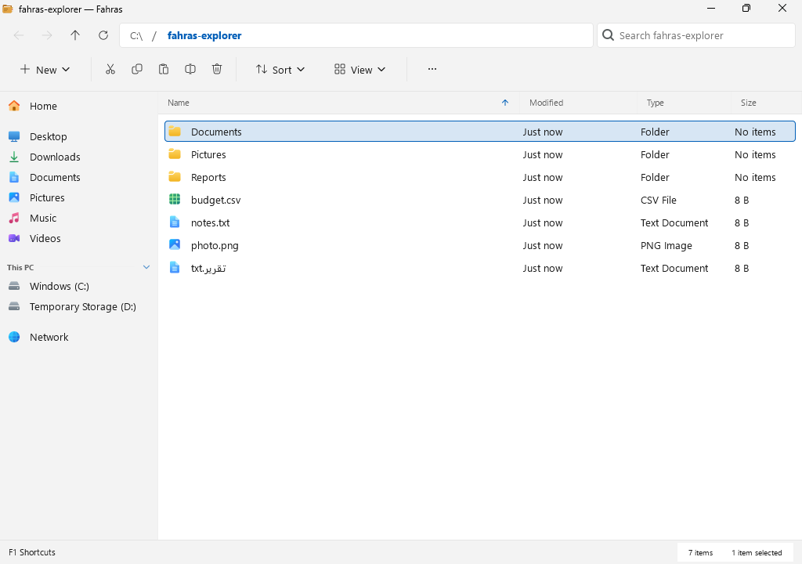
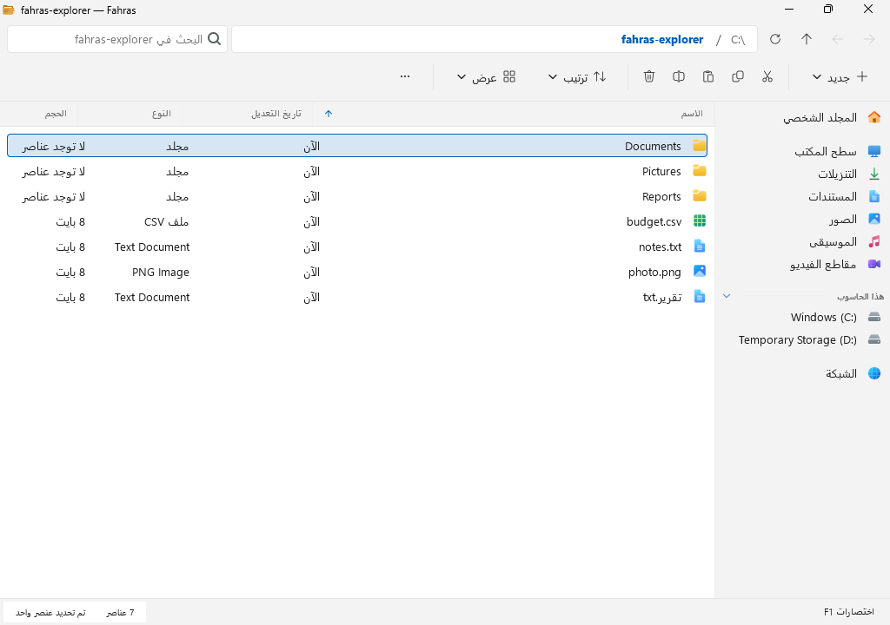

# Fahras · فهرس

**A fast, keyboard-first file manager for Windows and Linux.** 
Instant search, rich previews, sandboxed security, and full Arabic support.

[**العربية ⬇**](#arabic) · [Why Fahras](#why-fahras) · [Download](#download) · [Features](#features) · [Shortcuts](#keyboard-shortcuts) · [Roadmap](#roadmap)

> [!NOTE]
> **Fahras is in early development.** Try the Windows preview: download the installer from the [latest release](https://github.com/iBar8/Fahras/releases/latest).
> Star or watch the repository to follow along.

 Fahras on Windows 11 with the Explorer look.
  

 Fahras's own look, here on Linux.

## Why Fahras?

*Fahras* (فهرس) is Arabic for **index**: the list that helps you find anything fast.

- 🪟 **Feels like Windows.** An Explorer look with the Windows title bar, command bar, Details view, Explorer sidebar and Fluent icons. "Open in Fahras" in File Explorer, the real Windows right-click menu with your other apps' entries (7-Zip, Send to, Open with), and an option to open every folder in Fahras.
- ⚡ **Fast with huge folders.** A folder of 100,000 files loads in under two seconds on Linux, and the window never freezes.
- 🔍 **Instant search.** Fuzzy filename search across all your drives, with results as you type.
- 🛡️ **Safe previews.** Images, PDFs and videos are opened in an isolated sandbox, so a malicious file can't reach your system just by being previewed.
- ⌨️ **Keyboard-first.** Every action has a shortcut. The mouse is welcome but never required.
- ▶️ **Rich previews.** Markdown, code, PDFs, camera RAW photos, video storyboards and audio with a live spectrum.
- 🌍 **Arabic built in.** A full Arabic interface with proper right-to-left layout and 19 bundled Arabic fonts to choose from, plus 13 other languages.
- 🎨 **Your style.** 95 themes, light and dark, Windows 10 and 11 Explorer looks, and four app icons to choose from.

## Download

| Platform | Status |
|---|---|
| 🪟 **Windows 10 / 11** (x64) | 🧪 Preview: download `Fahras-Setup-…-x64.exe` from the [latest release](https://github.com/iBar8/Fahras/releases/latest) and run it. It installs for your account only, with no administrator rights. A portable `.zip` is there too. Windows warns because the installer is not signed yet (**More info → Run anyway**). |
| 🐧 **Linux** | 🚧 First Fahras release coming soon. Until then you can [build from source](docs/packaging.md). |

## Features

### Browsing
- **Three views:** Columns (like macOS Finder), Icons grid, and a sortable List.
- **Tabs, history and pins** for your favorite places.
- **Never freezes:** folders load in the background and only what's visible gets drawn.

### Search
- **Ctrl+K** searches your home folder and every mounted drive by name or path.
- **Ctrl+F** filters the current folder as you type.
- Results start appearing while the search is still running.

### Previews
- Press **Space** to preview almost anything: images, camera RAW, PDF, Markdown, HTML, source code, audio and video.
- **File Properties** shows media details: resolution, duration, codecs, HDR, camera, lens and GPS location.

### File operations
- Copy, move, rename, trash, permanent delete and new folders, all cancellable with progress.
- Browse inside ZIP, 7z, TAR and RAR archives.
- Drop images, text or links from a browser to save them as files.

### Power tools
- **Custom actions:** add your own scripts to the right-click menu.
- **Network locations:** SMB shares and SFTP servers.
- **Custom shortcuts** for every action, plus an optional Vim-style mode.

## Fahras vs. File Explorer

| | File Explorer | Fahras |
|---|:---:|:---:|
| Opens huge folders without freezing | ⚠️ | ✅ |
| Instant search without setting up indexing | ❌ | ✅ |
| Column view | ❌ | ✅ |
| Sandboxed file previews | ❌ | ✅ |
| Markdown, code, RAW and video previews | ⚠️ Limited | ✅ |
| Full keyboard control and custom shortcuts | ⚠️ | ✅ |
| Custom right-click actions without registry edits | ❌ | ✅ |
| Windows right-click menu with your other apps' entries | ✅ | ✅ |
| Themes | ❌ | ✅ 95 |
| Built into Windows, opens instantly | ✅ | ❌ |
| Open source | ❌ | ✅ |

## Keyboard shortcuts

| Action | Keys |
|---|---|
| Search everywhere | `Ctrl` `K` |
| Filter this folder | `Ctrl` `F` |
| Preview the selected file | `Space` |
| Rename | `F2` |
| Go to a path | `Ctrl` `L` |
| Back / Forward / Up one level | `Alt` `←` / `Alt` `→` / `Alt` `↑` |
| New tab / close tab | `Ctrl` `T` / `Ctrl` `W` |
| Refresh | `F5` |
| Settings | `Ctrl` `,` |
| **All shortcuts** | `F1` |

## Roadmap

**Phase 1: Foundation**
- [x] Fahras name, logo and repository
- [x] Windows build on GitHub Actions, tested on Windows with every build
- [x] Opens and browses folders and drives on Windows; copy, move, rename and delete to the Recycle Bin
- [x] Full Arabic translation with right-to-left layout and 19 Arabic fonts

**Phase 2: Everyday use on Windows**
- [ ] Recycle Bin, drives, USB eject
- [ ] Ultra-fast whole-drive search using the NTFS file table
- [ ] Windows thumbnails

**Phase 3: Previews and security**
- [ ] Sandboxed previews on Windows

**Phase 4: Integration**
- [x] "Open in Fahras" in File Explorer, and an option to open every folder in Fahras
- [x] The Windows right-click menu with other apps' entries (7-Zip, Send to, Open with)
- [ ] Network shares, run as administrator

**Phase 5: Release**
- [x] Installer in English and Arabic, first public release
- [x] Signed automatic updates on Windows

**Planned features**
- [x] Windows 10 and Windows 11 Explorer looks with Explorer's layout (Settings → Appearance → Look)
- [x] Choose your app icon: Manila, Forest, Ink or Clay
- [ ] Folder sizes in the list
- [ ] Dual-pane mode
- [ ] Batch rename with live preview
- [ ] Hijri dates alongside Gregorian
- [ ] Smart "Recent" view and colored favorites
- [ ] Duplicate file finder

## Credits

Fahras is built on [**Strata**](https://github.com/lgse/strata) by **LGSE Ltd.**, an excellent file manager for Linux. Thank you to its authors and contributors.
Fahras is an independent project and is not affiliated with or endorsed by LGSE Ltd.

Third-party components and their licenses are listed in [THIRD_PARTY_LICENSES.md](THIRD_PARTY_LICENSES.md).

## License

[MIT](LICENSE). Copyright © 2026 LGSE Ltd. and © 2026 iBar8.

 

---

# فهرس · Fahras

**مدير ملفات سريع لنظامَي ويندوز ولينكس، يمكنك التحكم فيه بالكامل من لوحة المفاتيح.** 
بحث فوري، ومعاينة غنية للملفات، وحماية بعزل الملفات، ودعم كامل للغة العربية.

> 📌 **فهرس في مرحلة التطوير الأولى.** جرّب النسخة التجريبية لويندوز: نزّل برنامج التثبيت من [أحدث إصدار](https://github.com/iBar8/Fahras/releases/latest).
> تابع المستودع ليصلك كل جديد.

 فهرس على ويندوز 11 بمظهر مستكشف الملفات.

## لماذا فهرس؟

**الفهرس** هو القائمة التي تساعدك على الوصول إلى أي شيء بسرعة، وهذا ما صُمم البرنامج من أجله.

- 🪟 **كأنه جزء من ويندوز.** مظهر مستكشف الملفات بشريط عنوان ويندوز، وشريط الأوامر، وعرض التفاصيل، والشريط الجانبي، وأيقونات Fluent. وأمر «فتح في فهرس» داخل مستكشف الملفات، وقائمة الزر الأيمن الأصلية في ويندوز مع أوامر برامجك الأخرى (7-Zip، وإرسال إلى، وفتح باستخدام)، وخيار لفتح كل المجلدات في فهرس.
- ⚡ **سريع مع المجلدات الضخمة.** يفتح مجلدًا فيه مئة ألف ملف في أقل من ثانيتين على لينكس، دون أن تتجمد النافذة.
- 🔍 **بحث فوري.** ابحث عن الملفات بالاسم في جميع أقراصك، وتظهر النتائج أثناء الكتابة.
- 🛡️ **معاينة آمنة.** تُفتح الصور وملفات PDF والفيديو داخل بيئة معزولة، فلا يستطيع ملف ضار أن يصل إلى نظامك لمجرد معاينته.
- ⌨️ **لوحة المفاتيح أولًا.** لكل أمر اختصار، ويمكنك استخدام الفأرة متى شئت.
- ▶️ **معاينة غنية.** ملفات Markdown، والشيفرة البرمجية، وPDF، وصور الكاميرا الخام (RAW)، والفيديو، والصوت.
- 🌍 **العربية جزء أساسي.** واجهة عربية كاملة من اليمين إلى اليسار، مع تسعة عشر خطًا عربيًا مدمجًا تختار منها ما يناسبك، إلى جانب ثلاث عشرة لغة أخرى.
- 🎨 **بأسلوبك.** خمسة وتسعون مظهرًا بألوان فاتحة وداكنة، ومظهر يشبه مستكشف الملفات في ويندوز 10 و11، وأربع أيقونات للبرنامج تختار منها.

## التنزيل

| النظام | الحالة |
|---|---|
| 🪟 **ويندوز 10 و11** (x64) | 🧪 نسخة تجريبية: نزّل `Fahras-Setup-…-x64.exe` من [أحدث إصدار](https://github.com/iBar8/Fahras/releases/latest) وشغّله. يُثبَّت لحسابك فقط ولا يحتاج صلاحيات المسؤول. ويتوفر أيضًا ملف `.zip` محمول. سيعرض ويندوز تحذيرًا لأن المثبّت غير موقّع بعد (**مزيد من المعلومات ← التشغيل على أي حال**). |
| 🐧 **لينكس** | 🚧 أول إصدار من فهرس قريبًا. يمكنك حتى ذلك الحين [بناؤه من الشيفرة المصدرية](docs/packaging.md). |

## المزايا

### التصفح
- **ثلاث طرق للعرض:** الأعمدة، والأيقونات، والقائمة القابلة للترتيب.
- **علامات تبويب، وسجل للتنقل، ومواضع مثبتة** للأماكن التي تزورها كثيرًا.
- **لا يتجمد أبدًا:** تُحمَّل المجلدات في الخلفية، ولا يُرسم إلا ما يظهر على الشاشة.

### البحث
- اضغط **Ctrl+K** للبحث في مجلدك الشخصي وجميع الأقراص بالاسم أو المسار.
- اضغط **Ctrl+F** لتصفية محتوى المجلد الحالي أثناء الكتابة.
- تبدأ النتائج بالظهور قبل أن ينتهي البحث.

### المعاينة
- اضغط **مسافة** لمعاينة أغلب الملفات: الصور، وصور الكاميرا الخام، وPDF، وMarkdown، وHTML، والشيفرة البرمجية، والصوت، والفيديو.
- **خصائص الملف** تعرض تفاصيل الوسائط: الدقة، والمدة، والترميز، وHDR، ونوع الكاميرا والعدسة، والموقع الجغرافي.

### العمليات على الملفات
- النسخ، والنقل، وإعادة التسمية، والنقل إلى سلة المحذوفات، والحذف النهائي، وإنشاء المجلدات، مع إمكانية الإلغاء وعرض التقدم.
- تصفح محتوى ملفات ZIP و7z وTAR وRAR دون فكها.
- اسحب الصور أو النصوص أو الروابط من المتصفح لحفظها ملفاتٍ.

### أدوات متقدمة
- **أوامر مخصصة:** أضف برامجك النصية إلى قائمة الزر الأيمن.
- **مواقع الشبكة:** المجلدات المشتركة (SMB) وخوادم SFTP.
- **اختصارات قابلة للتعديل** لكل أمر، مع وضع اختياري بأسلوب Vim.

## فهرس مقارنةً بمستكشف الملفات

| | مستكشف الملفات | فهرس |
|---|:---:|:---:|
| فتح المجلدات الضخمة دون تجمد | ⚠️ | ✅ |
| بحث فوري دون إعداد الفهرسة | ❌ | ✅ |
| عرض الأعمدة | ❌ | ✅ |
| معاينة الملفات في بيئة معزولة | ❌ | ✅ |
| معاينة Markdown والشيفرة والصور الخام والفيديو | ⚠️ محدودة | ✅ |
| تحكم كامل من لوحة المفاتيح واختصارات مخصصة | ⚠️ | ✅ |
| أوامر مخصصة في قائمة الزر الأيمن دون تعديل السجل | ❌ | ✅ |
| قائمة الزر الأيمن في ويندوز مع أوامر برامجك الأخرى | ✅ | ✅ |
| المظاهر | ❌ | ✅ 95 |
| مدمج في ويندوز ويفتح فورًا | ✅ | ❌ |
| مفتوح المصدر | ❌ | ✅ |

## اختصارات لوحة المفاتيح

| الأمر | المفاتيح |
|---|---|
| البحث في كل مكان | `Ctrl` `K` |
| تصفية المجلد الحالي | `Ctrl` `F` |
| معاينة الملف المحدد | `Space` |
| إعادة التسمية | `F2` |
| الانتقال إلى مسار | `Ctrl` `L` |
| رجوع / تقدم / المجلد الأعلى | `Alt` `←` / `Alt` `→` / `Alt` `↑` |
| علامة تبويب جديدة / إغلاقها | `Ctrl` `T` / `Ctrl` `W` |
| تحديث | `F5` |
| الإعدادات | `Ctrl` `,` |
| **جميع الاختصارات** | `F1` |

## خطة العمل

**المرحلة الأولى: الأساس**
- [x] الاسم والشعار والمستودع
- [x] بناء نسخة ويندوز تلقائيًا على GitHub واختبارها على ويندوز في كل مرة
- [x] فتح المجلدات والأقراص وتصفحها على ويندوز، مع النسخ والنقل وإعادة التسمية والحذف إلى سلة المحذوفات
- [x] ترجمة عربية كاملة مع واجهة من اليمين إلى اليسار وتسعة عشر خطًا عربيًا

**المرحلة الثانية: الاستخدام اليومي على ويندوز**
- [ ] سلة المحذوفات، والأقراص، والإخراج الآمن لأجهزة USB
- [ ] بحث فائق السرعة في القرص كله عبر جدول ملفات NTFS
- [ ] الصور المصغرة من ويندوز

**المرحلة الثالثة: المعاينة والأمان**
- [ ] معاينة معزولة على ويندوز

**المرحلة الرابعة: التكامل مع النظام**
- [x] أمر «فتح في فهرس» داخل مستكشف الملفات، وخيار لفتح كل المجلدات في فهرس
- [x] قائمة الزر الأيمن في ويندوز مع أوامر البرامج الأخرى (7-Zip، وإرسال إلى، وفتح باستخدام)
- [ ] مجلدات الشبكة، والتشغيل بصلاحيات المسؤول

**المرحلة الخامسة: الإصدار**
- [x] برنامج تثبيت بالعربية والإنجليزية، وأول إصدار عام
- [x] تحديثات تلقائية موقّعة على ويندوز

**مزايا مخطط لها**
- [x] مظهر مستكشف الملفات في ويندوز 10 و11 بتخطيطه نفسه (الإعدادات ← المظهر)
- [x] اختيار أيقونة البرنامج: مانيلا، أو الغابة، أو الحبر، أو الطين
- [ ] عرض أحجام المجلدات في القائمة
- [ ] وضع اللوحتين المتجاورتين
- [ ] إعادة تسمية مجموعة ملفات مع معاينة فورية
- [ ] عرض التاريخ الهجري بجانب الميلادي
- [ ] عرض ذكي للملفات الأخيرة، ومفضلة ملونة
- [ ] البحث عن الملفات المكررة

## شكر وتقدير

بُني فهرس على برنامج [**Strata**](https://github.com/lgse/strata) من شركة **LGSE Ltd.**، وهو مدير ملفات ممتاز لنظام لينكس. نشكر مطوريه وكل من ساهم فيه.
فهرس مشروع مستقل، ولا يتبع شركة LGSE Ltd. ولا يحظى بتأييدها.

## الترخيص

[رخصة MIT](LICENSE). حقوق النشر © 2026 LGSE Ltd. و© 2026 iBar8.

[⬆ العودة إلى الأعلى](#top)

